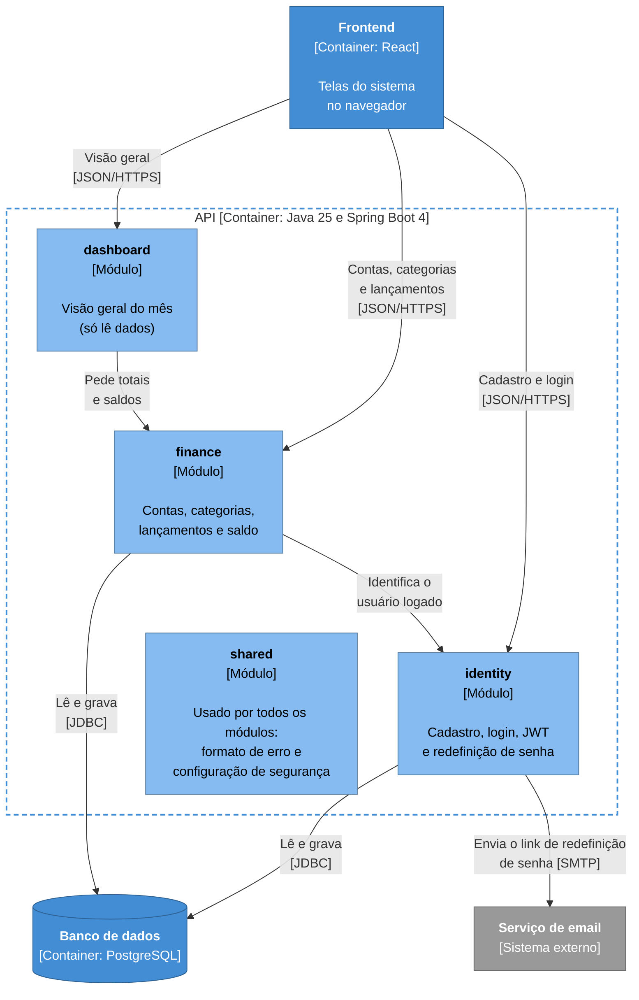

# Diagrama de componentes (C4 nível 3)

Abre a caixa da API e mostra os módulos que existem dentro dela e quem depende de quem (ADR 0004).

**Legenda:** azul-claro são os módulos da API, azul são os outros containers do meu sistema, cinza é sistema externo e a borda tracejada é o limite da API.

## O que o diagrama mostra

- **identity:** cadastro, login, autenticação com JWT e redefinição de senha (ADR 0010). Guarda os usuários e os tokens, e é o único módulo que envia email.
- **finance:** contas, categorias, lançamentos e o cálculo do saldo. Guarda as contas, as categorias e os lançamentos.
- **dashboard:** monta a visão geral do mês. Não tem tabelas próprias e não acessa o banco: pede os totais e os saldos ao `finance`.
- **shared:** o que é comum a todos, como o formato de erro (ADR 0009) e a configuração de segurança. Todos os módulos usam o `shared`, mas essas setas ficaram de fora para o diagrama não poluir.

## Regras entre os módulos

- As dependências vão num sentido só: `dashboard` → `finance` → `identity`. Nenhum módulo depende de quem está acima dele.
- Um módulo não usa as entidades nem os repositories de outro, só os services que o outro expõe. É por isso que o `dashboard` pede os dados ao `finance` em vez de consultar o banco.
- Essas regras são verificadas por um teste com o Spring Modulith (ADR 0004).

## O que fica de fora

- **As classes de cada módulo** (controllers, services, repositories): mudam o tempo todo, e o próprio código mostra isso melhor que um diagrama.
- **Investimentos:** quando chegarem, na v2, viram um novo módulo neste diagrama.
