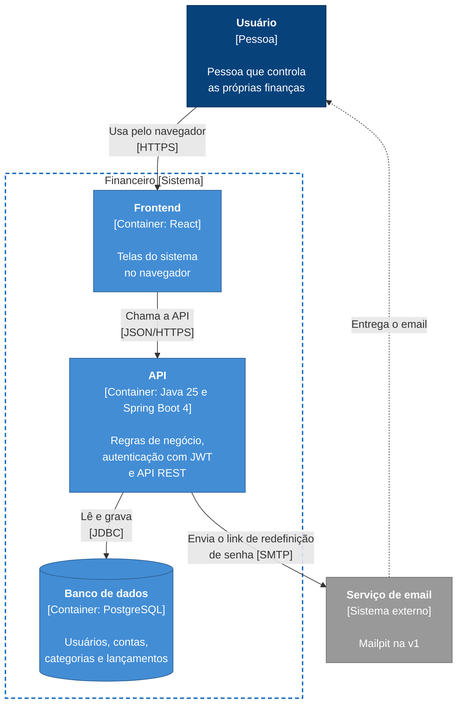

# Diagrama de containers (C4 nível 2)

Abre a caixa do sistema e mostra as partes que rodam separadas: o frontend, a API e o banco de dados, e como elas conversam.

**Legenda:** azul-escuro é pessoa, azul-claro são os containers do meu sistema, cinza é sistema externo e a borda tracejada é o limite do sistema.

No C4, "container" é qualquer parte que roda separada, como uma aplicação ou um banco de dados. Não é a mesma coisa que um container Docker, embora aqui cada um deles também rode num container Docker.

## O que o diagrama mostra

- **Frontend:** as telas que o usuário acessa pelo navegador, feitas em React. Ele fica no mesmo repositório do backend, mas é uma aplicação separada e só conversa com a API (ADR 0001). Vai ser feito depois do backend.
- **API:** o backend em Java 25 com Spring Boot 4 (ADR 0006). Tem as regras de negócio, a autenticação com JWT (ADR 0010) e as rotas REST em `/api` (ADR 0009). Por dentro, é organizada em módulos (ADR 0004).
- **Banco de dados:** o PostgreSQL, onde ficam usuários, contas, categorias e lançamentos. As tabelas são criadas pelas migrações do Flyway (ADR 0005).
- **Serviço de email:** usado só para o link de redefinição de senha (RF05). Na v1 é o Mailpit, que mostra os emails numa página local sem enviar de verdade.