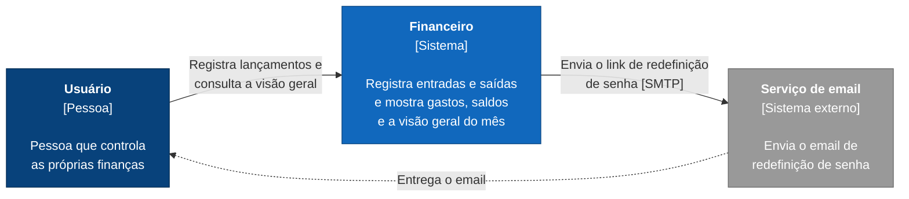

# Diagrama de contexto (C4 nível 1)

Mostra o sistema como uma caixa só: quem usa e com quais sistemas externos ele conversa.

**Legenda:** azul-escuro é pessoa, azul é o meu sistema e cinza é sistema externo.

## O que o diagrama mostra

- **Usuário:** quem usa o sistema para registrar lançamentos e acompanhar gastos e saldos. Na v1 sou só eu, mas o sistema já é multiusuário (ADR 0002).
- **Financeiro:** o sistema inteiro, visto de fora. As partes de dentro (frontend, API e banco de dados) aparecem no [diagrama de containers](c4-containers.md).
- **Serviço de email:** usado para enviar o link de redefinição de senha (RF05). Na v1 é o Mailpit, que roda localmente e só mostra os emails numa página, sem enviar de verdade (ADR 0010).

## O que fica de fora

- **Bancos:** não existe integração com banco. Os lançamentos são registrados à mão, conforme o escopo.
- **Serviço de cotações:** só entra com os investimentos, na v2. Quando entrar, vira um novo sistema externo neste diagrama.
