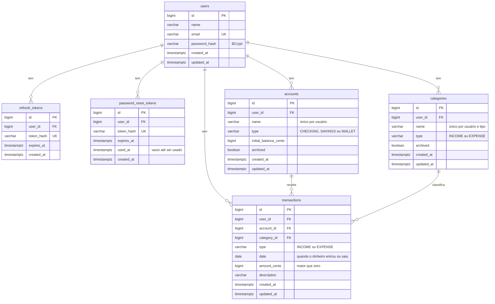

# Modelo de dados (DER)

Mostra as tabelas do banco, as colunas de cada uma e como elas se relacionam. É a base das primeiras migrações do Flyway (ADR 0005).

**Como ler:** `PK` é a chave primária, `FK` é a chave estrangeira e `UK` é um valor que não pode se repetir. A linha entre duas tabelas mostra a relação de um para muitos: um usuário tem zero ou mais contas, uma conta recebe zero ou mais lançamentos, e assim por diante.

## Tabelas por módulo

Cada módulo é dono das próprias tabelas (ADR 0004):

- **identity:** `users`, `refresh_tokens` e `password_reset_tokens`.
- **finance:** `accounts`, `categories` e `transactions`.
- **dashboard:** não tem tabelas. Ele pede os dados ao `finance`.

## Regras que o próprio banco garante

- O email não se repete entre usuários (RN02).
- O usuário não tem duas contas com o mesmo nome, nem duas categorias do mesmo tipo com o mesmo nome (RN10).
- O valor do lançamento é maior que zero (RN04).
- As chaves estrangeiras impedem apagar uma conta ou uma categoria que já tem lançamentos (RN08). Nesse caso, o sistema arquiva (`archived`).
- Os valores em dinheiro ficam em centavos, como `bigint` (RNF06 e ADR 0011).
- A data do lançamento é só a data, sem hora (RN06 e ADR 0011). As datas com hora (`created_at`, `updated_at`...) ficam em UTC.
- A tabela `transactions` tem um índice por conta e data, para o cálculo do saldo ser rápido (ADR 0012).

## Decisões de modelagem

- **`user_id` também em `transactions`:** daria para descobrir o dono pela conta, mas toda consulta filtra direto pelo usuário (ADR 0002). O service garante que a conta e a categoria são do mesmo usuário do lançamento.
- **`type` no lançamento e na categoria:** o tipo do lançamento precisa ser igual ao da categoria (RN05).
- **Sem coluna de saldo:** o saldo é calculado na hora a partir do saldo inicial da conta e dos lançamentos (ADR 0012).
- **Sem senha nem token em texto:** a senha fica só como hash BCrypt (RNF01), e os tokens ficam como hash (ADR 0010).
- **Os tipos** (`CHECKING`, `SAVINGS`, `WALLET`, `INCOME`, `EXPENSE`) são guardados como texto, com um `CHECK` no banco que só aceita esses valores.

## O que fica de fora

- **`flyway_schema_history`:** a tabela de controle do próprio Flyway, que não faz parte do domínio.
- **Transferências:** ainda estão nos pontos a decidir dos requisitos. Se entrarem, viram uma tabela nova neste diagrama.

## A decidir

- **Tipo do `id`:** `bigint` sequencial, como no springauth, ou UUID. Com `bigint` os ids são previsíveis, mas isso não expõe dados, porque um usuário não acessa dados de outro de qualquer forma (ADR 0002).
