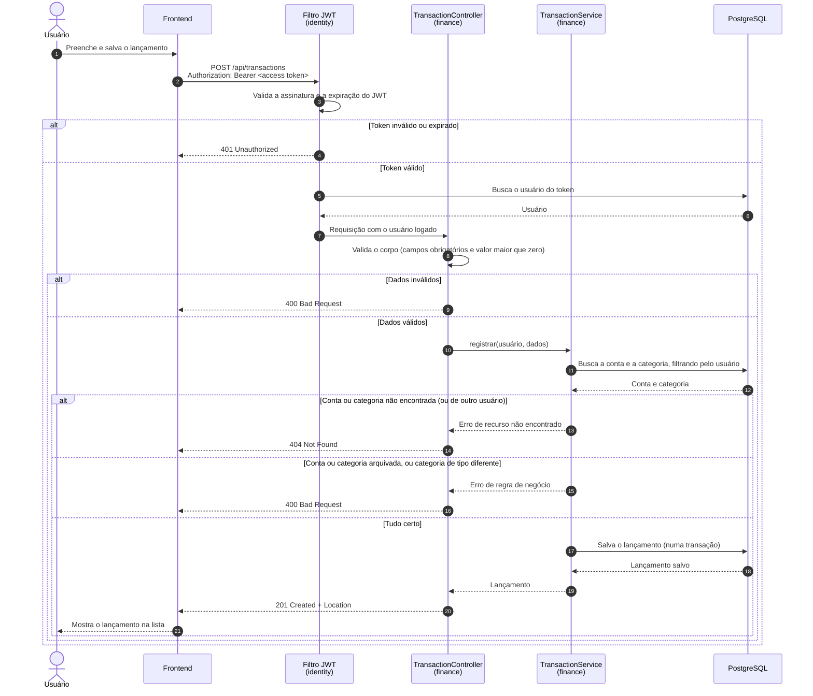

# Fluxos (diagramas de sequência)

Mostram, passo a passo e na ordem em que acontecem, como as partes do sistema conversam nos fluxos principais.

## Registrar um lançamento

É o fluxo central do sistema: passa pela autenticação, pela validação, pelas regras de negócio e pelo banco de dados.

### O que acontece em cada parte

- **Autenticação (passos 2 a 7):** o filtro valida o JWT e busca o usuário do token no banco. Se o token for inválido, estiver expirado ou o usuário não existir mais, a resposta é 401 (ADR 0010).
- **Validação do corpo (passos 8 e 9):** confere os campos obrigatórios e se o valor é maior que zero (RN04). O valor chega em centavos (ADR 0011).
- **Conta e categoria (passos 11 a 14):** a busca sempre filtra pelo usuário logado (RN01). Se a conta ou a categoria não existir, ou for de outro usuário, a resposta é 404, sem revelar que o dado existe (ADR 0002).
- **Regras de negócio (passos 15 e 16):** uma conta ou categoria arquivada não pode receber lançamentos novos (RN09), e a categoria precisa ser do mesmo tipo do lançamento (RN05).
- **Gravação (passos 17 a 20):** o lançamento é salvo numa transação (RNF07), e a API responde 201 com o endereço do recurso criado (ADR 0009).

Todas as respostas de erro seguem o formato Problem Details (ADR 0009).

O saldo da conta não é atualizado em nenhum lugar durante esse fluxo: ele é calculado na hora, quando uma tela pede o saldo (ADR 0012).
